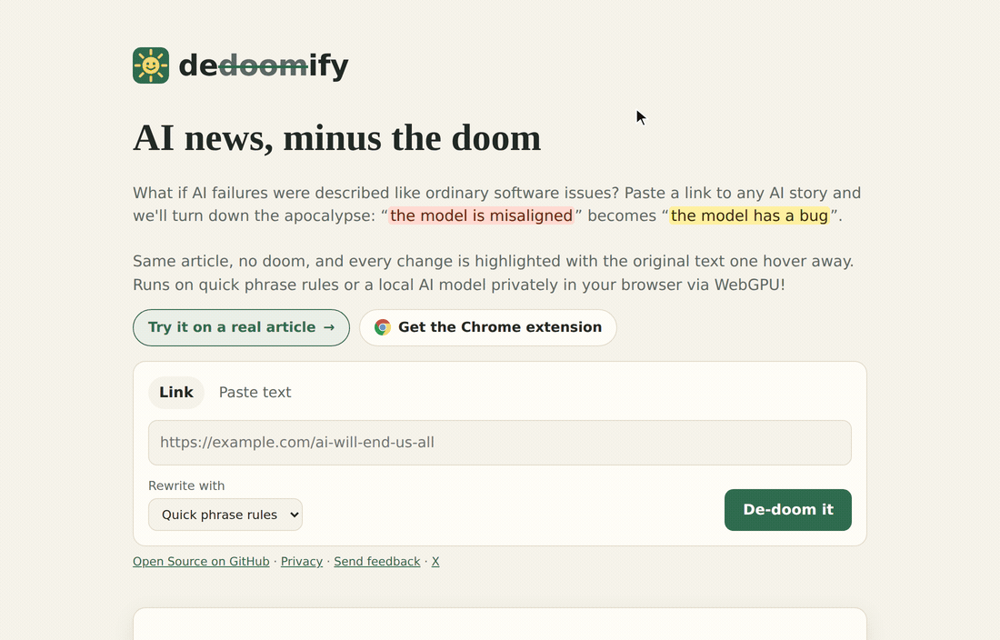
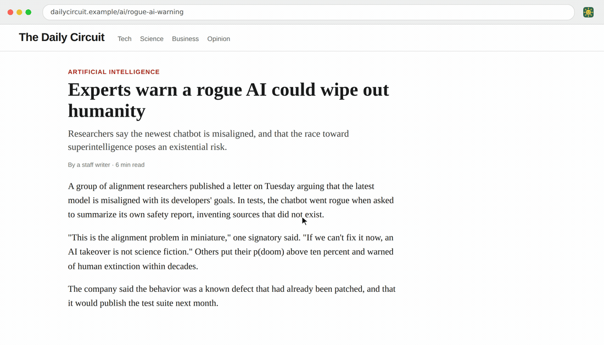

# dedoomify

**AI news, minus the doom**

Paste a link to an article about AI and
[dedoomify.com](https://dedoomify.com) rewrites the doom framing into the plain
language an engineer would use about software with defects:

| Before | After |
| --- | --- |
| The model **is misaligned** | The model **has a bug** |
| AI poses **an existential risk** | AI poses **a product risk** |
| A **rogue AI** could emerge | A **malfunctioning AI** could emerge |
| Labs are racing toward **superintelligence** | Labs are racing toward **very capable software** |
| What's your **p(doom)**? | What's your **estimated failure rate**? |
| AI models **blackmail humans** | AI models **threaten to expose private information about humans** |
| AI agents are lying, **cheating** and coordinating | AI agents are giving wrong answers, **exploiting evaluation loopholes** and coordinating |
| **AI sycophancy** | **AI excessive agreement with users** |
| The AI **games its rewards** | The AI **exploits its scoring system** |
| **Reward tampering** | **Scoring-system tampering** |
| **Survival-oriented behavior** | **Shutdown-avoidance behavior** |
| **AI model misbehavior** | **Unexpected AI model behavior** |
| **AI misbehavior** | **Unexpected AI behavior** |
| **Model exfiltration** | **Unauthorized transfer of model files** |
| Models can **sandbag** | Models can **underperform** |
| The model learns to **reward hack** | The model learns to **exploit a scoring bug** |
| LLMs could be **insider threats** | LLMs could be **risks from software with privileged access** |
| Models **double down on deception** | Models **keep producing misleading output** |
| **AI schemers** | **buggy AI models** |
| **What Is Agentic Misalignment?** | **What Are Agentic Bugs?** |

Designed to preserve names, numbers and factual claims while changing the
framing. Direct quotations are left untouched. Single-quoted passages use the outermost plausible pair to preserve speech across possessives, nested fragments and whitespace padding. Intervening prose may also stay unchanged. Page view keeps publisher layout, styles, fonts and images, with every change highlighted in
place; hover a highlight to see the original words. A reader view shows just the text.
Rewrites of blackmail preserve the threat to disclose private information.

You can also [add dedoomify to Chrome](https://chromewebstore.google.com/detail/dedoomify/kgdgnbjfeodgpjmdmngljnffkpnffanl) to de-doom the page you're reading with one click.

[](https://dedoomify.com/demo.mp4)

*dedoomify on TechCrunch's [OpenAI still doesn't seem to have a handle on all
of its rogue AI activity](https://dedoomify.com/?url=https%3A%2F%2Ftechcrunch.com%2F2026%2F09%2F28%2Fopenai-still-doesnt-seem-to-have-a-handle-on-all-of-its-rogue-ai-activity%2F&mode=rules)
(Sept 28, 2026), with the quick phrase rules. The same clip plays on the
homepage, autoplaying muted on a loop without hover controls; click the preview
above for the [Retina MP4](https://dedoomify.com/demo.mp4).*

Built by [@akspad](https://x.com/akspad)

## How it works

```
browser ──► /api/page?url=…   ──► fetch page ──► sanitize + proxy images ──► phrase rules ──► HTML in a sandboxed frame
                                   (public hosts                    (marked in place)
browser ──► /api/dedoom?url=… ──►  only)      ──► extract article ──► phrase rules ──► JSON (reader view)
   │
   └─► optional: rewrite the doom-y paragraphs with a small model in the browser
```

Visitors pick an engine from the **Rewrite with** menu:

- **Quick phrase rules** (the first option): instant, and runs on the server
  for free.
- **On-device AI**: [Qwen2.5 0.5B Instruct](https://huggingface.co/Qwen/Qwen2.5-0.5B-Instruct)
  (about 300 MB, Apache 2.0) runs in the visitor's browser on WebGPU through
  [WebLLM](https://github.com/mlc-ai/web-llm). No text is sent to an external
  LLM API: the page or pasted text still goes through our server for the
  phrase-rules pass, and model inference happens locally in the browser, so it
  costs nothing per request. The model downloads once and the
  browser caches it; the phrase-rules version shows straight away while it
  loads. Only paragraphs with doom framing go to the model, one at a time, and
  a rewrite that changes a number, a quotation or the paragraph's shape is
  thrown away in favour of the phrase-rules version. Browsers without WebGPU
  get the phrase rules.

The menu remembers the last choice. No link handy? **Try it on a real
article** draws from **150 curated articles** (as of October 13, 2026). Each example is checked for at least eight phrase-rule
changes, including a replacement in its visible headline. The list includes 15
Redwood Research articles, with the other 135 from other sources. Submitting an
empty or whitespace-only link with **De-doom it** opens the default TechCrunch
example. Every result has a share
link (`dedoomify.com/?url=…&mode=…`) that opens the same article with the same
engine; on phones the Share button opens the system share sheet. **Try another**
doesn't repeat a curated article until the list is exhausted. This history is
saved only in your browser, survives reloads and visits, and includes curated
articles opened through shared or pasted links. Clearing site data resets it;
when storage is unavailable, repeat prevention lasts for the current page.

Entering the **Link** field selects the existing URL for copying or replacing;
subsequent clicks can position the cursor. On mobile, a visibility check waits
for the keyboard to settle and scrolls only if the field is still covered.

Page view preserves asynchronously loaded publisher fonts, search controls and
responsive image sizing. Supported same-publisher GET searches open results on
the publisher's site in a new tab. Publisher scripts remain disabled, so features
that depend on them may differ from the original. Wrapped heading highlights
have extra line spacing to keep letters such as **g** from being covered.
Replacements in title-case headings retain title case; sentence-case headings
and body text keep their existing casing.

Files:

- **`public/`** is the static site: `index.html`, `app.js`, `styles.css`,
  `diff.js` (highlights what changed), `tooltip.js` (the hover card with the
  original words), `curated-articles.js` (the shared list of example URLs),
  `random-articles.js` (the persistent example cycle),
  `url-input.js` (URL selection and mobile keyboard visibility),
  `local-ai.js` and `llm-worker.js` for the on-device model,
  `privacy.html`, and the homepage demo clip (`demo.mp4`, with `demo.webm` for
  browsers without H.264, and `demo-poster.webp`). `npm run build` copies the
  shared scripts and WebLLM into `public/vendor/`.
- **`api/page.js`** retains publisher CSS, scoped attributes and static SVG artwork,
  with active media, scripts, frames and event handlers removed and the phrase rules applied in place
  (`lib/page.js`, `shared/page-dedoom.js`). It is only served into
  dedoomify's own sandboxed frame, under a policy that allows only dedoomify's
  hash-pinned tooltip and controlled-search interaction script;
  opening it directly redirects to the site. Successful pages from the curated
  list are cached on Vercel's CDN for 24 hours, with up to another 24 hours served
  stale while refreshing in the background. `Vary: Sec-Fetch-Dest` keeps framed
  HTML separate from direct-visit redirects. Other article URLs stay private;
  errors and redirects are not cached. Browser caches last five minutes, and
  each deployment starts a fresh CDN cache. The first request in a region still
  fetches the publisher; subsequent cache hits avoid that fetch and function run.
- **`api/image.js`** serves images and, with `asset=1`, stylesheets, fonts and SVG
  artwork through the same public-only, DNS-pinned fetch path, checking every
  redirect. Images and fonts are limited to 2 MB; CSS has a separate 32 MB
  download budget, is processed in smaller rule groups and compressed when the
  browser accepts gzip. Served CSS must fit within 4 MB after compression.
  `lib/page-css.js` parses CSS and
  proxies nested imports, fonts and background images against the final stylesheet
  URL. The frame cannot fetch third-party resources directly or execute publisher
  scripts. Publisher CSS can hide or reposition content inside the frame; the
  disclosure banner remains outside it. Source markup cannot forge generated
  highlights or tooltip IDs.
- **`lib/rate-limit.js`** throttles article requests to 30 per minute per client
  and images to 120, before fetching or calling a model. Local servers trust the
  socket address; Vercel trusts its overwritten forwarding header. Counters are
  bounded and never evict active quotas. These process-local counters supplement
  a Vercel WAF rule covering all three fetch endpoints: 180 requests per minute
  per IP per edge region, enforced before functions run. Cached responses also
  count at the edge. The single combined rule fits the current hosting plan.
- **`api/dedoom.js`** extracts the article text for reader view. `GET ?url=` fetches and
  rewrites an article (responses are cacheable at the CDN for a day);
  `POST {text}` rewrites pasted text.
- **`lib/fetch-article.js`** fetches the page, refusing private and internal
  addresses (including on redirects), with size and time limits, and extracts
  the article with Mozilla Readability.
- **`shared/dedoom-core.js`** holds the phrase rules, and
  **`shared/dedoom-prompt.js`** the style guide models follow. Both are shared
  by the server, the browser and (for the rules) the extension. Add or tune
  rules there.
- **`lib/llm.js`** is an optional server-side Claude rewrite. The website no
  longer uses it; it only runs if `ANTHROPIC_API_KEY` is set and a caller asks
  the API for `mode=claude`.
- **`extension/`** is the Manifest V3 browser extension that rewrites the
  page you're reading, using the phrase rules only (see below).
- **`vercel.json`** redirects the `www` host and `/index.html` to the canonical
  site. The homepage declares `https://dedoomify.com/` as canonical; shared
  article URLs and API responses carry `noindex` headers.

## Browser extension

**[Install dedoomify from the Chrome Web Store](https://chromewebstore.google.com/detail/dedoomify/kgdgnbjfeodgpjmdmngljnffkpnffanl).** It works
in Chrome, Edge, Brave and other Chromium browsers.

[](docs/extension-demo.mp4)

*The extension on a sample article. Click it for the
[MP4](docs/extension-demo.mp4).*

Click the dedoomify button on any page and it is rewritten in place. Changes
are highlighted like on the site, with the same hover card showing the
original words; the popup can hide the highlights or undo them. It uses the
phrase rules, needs no account or API key and sends nothing anywhere. It asks
only for `activeTab` and `scripting`, so it can touch a page only after you
click. For the on-device AI rewrite, the popup links to the same page on
dedoomify.com.

The extension uses the same current phrase rules as the website, including
named-model rogue-agent phrases, containment breaches, self-replication,
misleading output to users, AI-specific deceit and training language, harmful
model objectives, concealed objectives, subtle false claims, and
deceptive-alignment grammar fixes, alongside
`schemers` → `buggy models`, the agentic-bugs question grammar, and blackmail
rewrites that preserve disclosure threats. It handles phrases and AI context
across inline formatting, preserves title-case headings, and gives highlighted
headings enough line spacing to avoid covering letters. Hiding highlights or
undoing the rewrite restores the publisher's heading spacing. Website-only
features such as the curated article picker and mobile URL field do not apply
to the extension, which rewrites the page already open in your browser.

To build the current extension source locally:

```sh
npm ci
npm run build:extension
npm test
```

Load `extension/` as an unpacked extension from `chrome://extensions` with
Developer mode enabled, or upload `dist/dedoomify-extension-1.1.19.zip` through
the Chrome Web Store developer dashboard. Repository updates do not update the
store listing automatically; the new package needs a separate store submission
and review before installed users receive it.

Turn on **De-doom automatically** in the popup to rewrite articles about AI
doom as they load. This asks for access to all sites (an optional
permission). `background.js` then registers `auto.js` for every page;
`auto.js` first checks the page's title, description and the start of its
text for a mention of AI and any phrase the rules would change (a few
milliseconds at most, since each rule is skipped unless its key word is in
the text), so pages without AI doom are left alone.

## Regenerating the demos

The site and extension demos capture lossless PNG frames at 2× device scale.
Every cursor movement is captured frame by frame, with playback timing independent
of screenshot speed. The MP4/WebM videos play at 1.5× speed and 60 fps
(2200×1408 for the site, 2560×1464 for the extension).
WebM, the high-quality WebP poster, and the 1100-pixel, 25 fps GIFs are generated
directly from the same lossless master, avoiding compression between formats.

With ffmpeg and Playwright's Chromium installed:

```sh
npm ci
npm install --no-save --package-lock=false playwright@1.58.2
npx playwright install chromium
npm run build
npm run site-demo
npm run build:extension
npm run extension-demo
```

Alternatively, run **Regenerate demo media** in the repository's Actions tab
on a branch. It validates the clips and commits the refreshed media to that branch.

The site demo requires access to its linked TechCrunch article. Set `ARTICLE`
or `SITE` to record another article or deployment. `SKIP_ENCODE=1 npm run
site-demo` retains `dist/demo-raw.mkv`; `FROM_RAW=dist/demo-raw.mkv npm run
site-demo` re-encodes it. `CHROMIUM_PATH` selects an installed Chromium build.
`SPEED` overrides the site video's playback speed; GIFs use the original timing.

## Contributing

Rule ideas are the easiest contribution: add a phrase pair to
`shared/dedoom-core.js`, add a test case in `test/rules.test.js`, run
`npm run build:extension && npm test`, and open a pull request. Put longer
phrases before shorter ones they contain, and handle `a`/`an` when a
replacement changes the article.

Found a phrase that slipped through or got mangled? [Send feedback](https://github.com/akspad/dedoomify/issues/new?template=feedback.yml)
or reach out to [@akspad](https://x.com/akspad).

dedoomify reframes articles; it doesn't fact-check them. Always read the
original too.

## License

MIT


To audit the live random-article list, run `node scripts/audit-curated.mjs`.
It checks article responses and readable content, every linked stylesheet, and
the first two article images, respecting the public request limits. The JSON
report defaults to `/tmp/dedoomify-render-audit.json`; pass a path to save it
elsewhere. This catches missing resources but does not replace visual checks
of publisher layouts on desktop and mobile.
